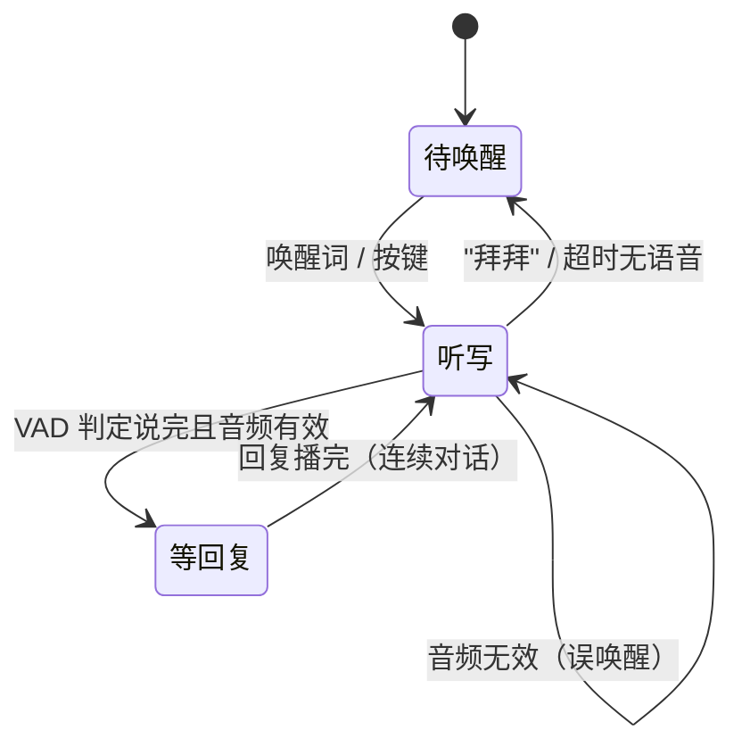

# ESP-AI 智能语音助手

> 在 ESP32-S3 上跑通的一条完整语音交互链路：**唤醒词 → 本地命令词 → 大模型多轮对话**。
> A complete voice-assistant pipeline on ESP32-S3: **wake word → on-device commands → LLM conversation**.

[](https://github.com/ASUKA02eva/esp-aichat/actions/workflows/build.yml)


作者：[@ASUKA02eva](https://github.com/ASUKA02eva) · 中文 | [English](#english)

---

## English

A voice assistant firmware for **ESP32-S3** built on **ESP-IDF 5.4 + ESP-SR**, merging offline
speech recognition with an LLM backend into a single application.

**Highlights**

- **Wake word** (default 「你好小智」, ESP-SR WakeNet9) or a hardware button press.
- **On-device command recognition** (MultiNet7, Chinese) with zero network latency —
  switch the LED on/off, drive an SG90 servo, or end the session.
- **LLM conversation** over WebSocket: audio is streamed to a small Python server on your PC,
  and the reply is played back as a streaming audio feed. Multi-turn dialogue without
  repeating the wake word.
- **Graceful offline fallback**: if Wi-Fi or the server is unreachable, the device keeps working
  with wake word + local commands only.
- All parameters (Wi-Fi, server URI, pins, timeouts) are configurable via `idf.py menuconfig`.
- Implemented as one ESP-IDF project: `main/` (application + state machine) plus reusable
  `components/` (BSP, audio manager, Wi-Fi, WebSocket, LED, button, servo, voice assets).

**Build**

```bash
idf.py set-target esp32s3
idf.py menuconfig      # set Wi-Fi SSID / password and the WebSocket server URI
idf.py build flash monitor
```

Dependencies are pinned (`espressif/esp-sr == 2.1.3`, `espressif/esp_websocket_client == 1.4.0`)
because esp-sr ≥ 2.2 pulls in `esp-dl`, which requires ESP-IDF ≥ 5.5.

Licensed under Apache-2.0. See [参考与致谢](#参考与致谢) for upstream credits.

---

## 项目简介

这是一个跑在 ESP32-S3 上的语音助手固件，目标是把"能听懂人话的硬件"这条链路一次性打通：

- **离线部分**在芯片上完成 —— 唤醒词检测、中文命令词识别、噪声抑制、VAD 断句、音频播放，
  不依赖网络，响应快、隐私好；
- **在线部分**接大模型 —— 当用户说的话没命中本地命令时，音频通过 WebSocket 送到电脑上的
  Python 服务端，由大模型理解并生成回复语音，流式传回设备播放，支持连续多轮对话。

整机只需要一块 ESP32-S3 开发板 + 一个数字麦克风 + 一个数字功放，加上可选的 LED、按键和舵机。
固件实测体积约 **1.87 MB**（app 分区 3 MB，余量 38%），语音模型独立占用 6 MB 的 `model` 分区。

## 功能特性

| 能力 | 说明 |
| --- | --- |
| 语音唤醒 | ESP-SR WakeNet9，默认唤醒词「你好小智」，可在 menuconfig 更换 |
| 按键唤醒 | 外接按键，按一下等同于说唤醒词 |
| 本地命令词 | MultiNet7 中文模型，设备端识别，**不走网络、零延迟** |
| 大模型对话 | WebSocket + 流式音频，支持多轮连续对话 |
| 离线降级 | 连不上 Wi-Fi 或服务端时自动切到纯离线模式，不会卡死 |
| VAD 断句 | 自动判断"开始说话 / 说完了"，不需要按键结束 |
| 噪声抑制 | 模型存在时自动启用（可选能力） |
| 动作反馈 | LED 表示灯的状态，SG90 舵机给出物理动作，每个命令都有语音确认 |
| 全参数化 | Wi-Fi、服务端地址、引脚、超时、舵机角度等全部走 `menuconfig` |
| 工程化 | 单一 ESP-IDF 工程，模块拆分为可复用组件，CI 自动编译验证 |

## 硬件与接线

| 部件 | 型号 | 备注 |
| --- | --- | --- |
| 开发板 | ESP32-S3-DevKitC-1 | 需 16 MB Flash + 8 MB PSRAM |
| 麦克风 | INMP441 | I2S 数字麦克风 |
| 功放 | MAX98357A | I2S 数字功放 |
| 喇叭 | 4Ω 3W | 接在功放 `+/-` |
| LED | 任意 | 建议串 220Ω 限流电阻，可选 |
| 按键 | 轻触按键 | 可选 |
| 舵机 | SG90 180° | 可选，开关灯的动作反馈 |

```text
麦克风(INMP441) → ESP32-S3         功放(MAX98357A) → ESP32-S3
---------------------------         ---------------------------
VDD → 3.3V    GND → GND             VIN → 3.3V    GND → GND
SD  → GPIO6   WS  → GPIO4           DIN → GPIO7   BCLK → GPIO15
SCK → GPIO5                         LRC → GPIO16

LED   : 长脚 → GPIO21, 短脚 → GND（串限流电阻）
按键  : 一端 → 3V3,  另一端 → GPIO41（按下为高电平）
SG90  : 红线 → 5V,   棕线 → GND, 橙线 → GPIO18
喇叭  : 正极 → 功放 +, 负极 → 功放 -
```

> 除麦克风/功放的 I2S 引脚（在 `components/bsp_board/bsp_board.cc` 中定义，沿用原硬件方案）
> 之外，其余引脚都可以在 `menuconfig` 里改。

## 快速开始

### 开发环境

- ESP-IDF **v5.4**（含 `idf.py`）
- Python 3.8+（只有跑大模型服务端时才需要）

首次编译需要联网：组件管理器会从 Espressif 组件仓下载 `esp-sr` 和 `esp_websocket_client`。

### 1. 配置

```bash
idf.py set-target esp32s3     # 会自动读取 sdkconfig.defaults.esp32s3
idf.py menuconfig             # → ESP-AI 智能语音助手配置
```

至少要设置这两项（只想跑离线功能可以都不填）：

| 配置项 | 说明 |
| --- | --- |
| `WiFi 名称 (SSID)` / `WiFi 密码` | 留空 = 纯离线模式 |
| `大模型服务端地址 (WebSocket)` | 例如 `ws://192.168.1.100:8888`，填电脑的局域网 IP |

唤醒词默认「你好小智」；要更换请到 `menuconfig` → `ESP Speech Recognition` →
`Load Multiple Wake Words`。

### 2. 编译与烧录

```bash
idf.py build
idf.py -p COMx flash monitor
```

看到 `✅ 系统就绪，请说"你好小智"或按按键开始对话` 即启动成功。

### 3. 大模型服务端（可选）

只做离线功能可以跳过；想聊天则先起服务端，再把它的地址填进上面第 1 步。

```bash
cd server
pip install -r requirements.txt
set DASHSCOPE_API_KEY=sk-xxxxxxxx        # Windows CMD
# $env:DASHSCOPE_API_KEY="sk-xxxxxxxx"   # PowerShell
python server.py
```

启动后终端会打印 `ws://<电脑IP>:8888`。注意放行电脑防火墙的 8888 端口。

### 依赖版本说明

`main/idf_component.yml` 与 `components/ws_client/idf_component.yml` 里对依赖做了**硬锁定**：

```yaml
espressif/esp-sr: "==2.1.3"              # 而非 ^2.1.0
espressif/esp_websocket_client: "==1.4.0"
```

原因：`esp-sr` 从 2.2 起把部分能力交给 `esp-dl` 提供，而 `esp-dl` 要求 **ESP-IDF ≥ 5.5**，
与本工程的 5.4 不兼容，升级第三方依赖会直接编译失败（`'MALLOC_CAP_SIMD' was not declared`）。
如果以后把 ESP-IDF 升到 5.5+，可以放宽成 `^2.1.0`。

## 配置项

`menuconfig` → **ESP-AI 智能语音助手配置**：

| 配置项 | 默认值 | 说明 |
| --- | --- | --- |
| `APP_LLM_ENABLE` | y | 是否启用大模型对话（关掉 = 纯离线） |
| `APP_WIFI_SSID` / `APP_WIFI_PASSWORD` | 空 | Wi-Fi 账号密码（留空 = 离线模式） |
| `APP_WS_URI` | `ws://192.168.1.100:8888` | 大模型服务端地址 |
| `APP_LED_GPIO` | 21 | LED 引脚 |
| `APP_ENABLE_BUTTON` / `APP_BUTTON_GPIO` | y / 41 | 按键唤醒 |
| `APP_ENABLE_SERVO` / `APP_SERVO_GPIO` | y / 18 | 舵机 |
| `APP_IDLE_TIMEOUT_MS` | 10000 | 等待说话 / 等待命令的超时 |
| `APP_CMD_CONFIRM_ROTATE_DEG` | 45 | 开关灯时舵机转动角度 |
| `APP_MAX_RECORDING_SEC` | 10 | 单次最长录音时长 |
| `APP_VAD_SILENCE_MS` | 600 | 静音多久算"说完了" |

引脚与音频参数的具体取值见 `main/app_config.h`。

## 使用说明

### 交互流程



### 语音命令

| 你说的话 | 效果 |
| --- | --- |
| 「你好小智」或按按键 | 唤醒：LED 闪一下 + 欢迎音，进入听写 |
| 「帮我开灯」 | LED 点亮 + 舵机点头 + 开灯确认音 |
| 「帮我关灯」 | LED 熄灭 + 舵机反向点头 + 关灯确认音 |
| 「现在安全屋情况如何」 | 播放自定义音频（演示自定义命令词） |
| 「拜拜」 | 播放再见音，回到待唤醒 |
| 其他任何话 | 交给大模型，进入多轮对话（不用再说唤醒词） |
| 连续 10 秒不说话 | 自动播放再见音并退出对话 |

本地命令词定义在 `main/voice_engine.cc` 的命令表里，动作分派在 `main/main.cc` 的
`run_local_command()`。要加自己的命令：表格里加一行（ID + 拼音 + 说明），再补一个分支即可。

### LED / 按键 / 舵机

- **LED** 表示"灯"的开关状态，由开关灯命令控制；唤醒时会闪一下但会恢复原状态。
- **按键** 只在待唤醒状态生效，作用等同于说唤醒词。
- **舵机** 在收到开关灯命令时转出去、停 0.8 秒、再转回原角度，作为物理动作反馈。

### 两种工作模式

- **在线模式**：Wi-Fi 和服务端都连上时，唤醒后既可下本地命令，也可以直接和 AI 聊天。
- **离线模式**：未配置 Wi-Fi、或 Wi-Fi / 服务端连接失败时自动进入，只保留唤醒词与本地命令词，
  不影响开关灯等本地控制。

## 目录结构

```text
esp-aichat/
├── CMakeLists.txt              顶层工程（唯一构建入口）
├── partitions.csv              app 3MB + 语音模型 6MB + nvs/phy
├── sdkconfig.defaults(.esp32s3) 默认配置（ESP32-S3 专用项）
├── main/
│   ├── main.cc                 状态机：待唤醒 → 听写 → 等回复
│   ├── voice_engine.{h,cc}     唤醒词 / 命令词 / 降噪（封装 ESP-SR）
│   ├── app_config.h            引脚与音频、行为参数
│   └── Kconfig.projbuild       menuconfig 配置项
├── components/
│   ├── bsp_board/              INMP441 + MAX98357A（I2S）
│   ├── audio_manager/          录音缓冲 / 播放 / 流式播放
│   ├── wifi_manager/           Wi-Fi STA 连接
│   ├── ws_client/              WebSocket 客户端（文本 + 二进制 + 自动重连）
│   ├── led_control/            外接 LED
│   ├── button_control/         外接按键（带去抖）
│   ├── servo_control/          SG90 舵机（LEDC 50Hz）
│   └── voice_assets/           提示音头文件（纯头文件组件）
├── assets/mock_voices/         提示音 mp3 源文件
├── server/                     电脑端 Python 大模型服务端
├── tools/                      音频转 C 头文件、命令词拼音工具
└── docs/ARCHITECTURE.md        架构说明：分层、状态机、通信协议
```

组件之间只有 `audio_manager → bsp_board` 一条依赖，其余互不引用；
`main` 依赖所有组件。整体设计见 [docs/ARCHITECTURE.md](docs/ARCHITECTURE.md)。

### 更换提示音

把 mp3 放进 `assets/mock_voices/`（文件名即数组名），然后：

```bash
cd tools
pip install -r requirements.txt   # 需要系统里有 ffmpeg
python convert_audio.py
```

脚本会把 mp3 转成 16 kHz / 单声道 / 16 bit 的 C 头文件，输出到
`components/voice_assets/include/mock_voices/`，在代码里 `#include "mock_voices/xxx.h"` 即可用。

## 项目状态与路线图

**已完成**

- 唤醒词 + 中文命令词 + 大模型对话的完整链路，单一固件、单一工程
- 命令词优先策略（命中本地命令就作废本轮上传，避免服务端收到半句话）
- 断连降级、等待回复超时兜底
- 参数全部收敛到 `menuconfig`
- GitHub Actions 自动编译验证（ESP-IDF v5.4 / esp32s3）

**已知限制**

- 提示音播放和舵机动作是**阻塞**执行的，会短暂占用主循环；多路动作建议挪到独立任务。
- 本地命令词只在**听写状态**生效，待唤醒时说"开灯"无效（需先唤醒）。
- 仅支持单唤醒词模型；唤醒后固定使用同一套命令表。
- 模块 I2S 引脚目前写在 `components/bsp_board/bsp_board.cc` 里，未做成配置项。

**计划**

- [ ] 舵机动作移到独立任务，避免阻塞音频循环
- [ ] LED 状态指示（待机 / 录音 / 说话）与呼吸灯
- [ ] 多唤醒词切换、更多自定义命令
- [ ] OTA 升级
- [ ] 把 I2S 引脚也纳入 `menuconfig`

## 故障排查

| 现象 | 排查方向 |
| --- | --- |
| 没有声音 | MAX98357A 接线与 3.3V 供电；喇叭是否接在功放 `+/-` |
| 识别不准 | 安静环境、距麦克风 20~50 cm；把 `DET_MODE_90` 改成 `DET_MODE_95`（更严格，见 `main/voice_engine.cc`） |
| 唤醒无反应 | 串口确认模型是否烧进 `model` 分区（`0x2fe000` 起）；`sdkconfig` 里唤醒词模型是否选中 |
| 连不上服务端 | 电脑防火墙放行 8888；`APP_WS_URI` 填的必须是电脑局域网 IP 而非 `localhost` |
| 编译报 `MALLOC_CAP_SIMD` | 依赖版本被放开导致拉到新版 `esp-sr`/`esp-dl`，恢复上面的版本锁定 |
| 内存不足 | 确认开发板带 PSRAM，且 `sdkconfig.defaults.esp32s3` 已生效 |
| 启动即重启 | 检查是否误把 `APP_*` 引脚设成已被 I2S 占用的 GPIO（4/5/6/7/15/16） |

串口日志用 `idf.py monitor` 查看，各阶段都会打印明确的状态与错误信息。

## 参考与致谢

- [78/xiaozhi-esp32](https://github.com/78/xiaozhi-esp32) —— 小智 AI 的开源实现，本项目的
  交互思路、硬件接线方案与语音链路设计参考了它。
- [shenjingnan/xiaozhi-replica](https://github.com/shenjingnan/xiaozhi-replica) —— 本项目最早由
  该项目中 5 个独立的语音示例（控制 LED、唤醒词、命令词识别、舵机、接入大模型）合并重构而来，
  现已整理为单一固件工程：公共部分抽成 `components/` 组件，业务部分收敛到 `main/` 里的状态机。
- 语音能力来自 Espressif 的 [ESP-SR](https://github.com/espressif/esp-sr)（WakeNet / MultiNet），
  构建与组件管理由 ESP-IDF 提供。

## 许可

[Apache License 2.0](LICENSE) —— 可自由用于个人或商业项目，保留原始版权声明即可。
