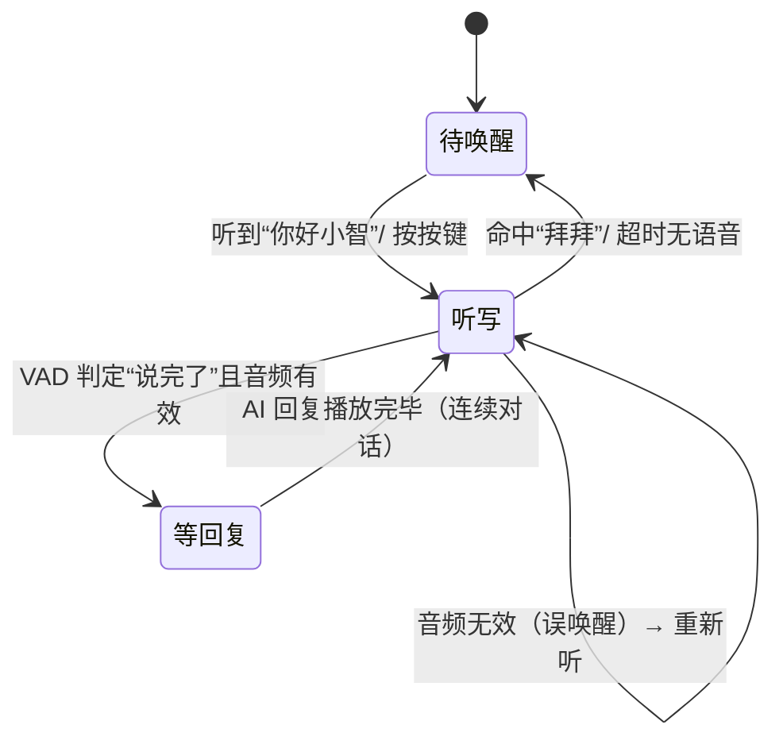

# 架构说明

本文说明 `esp-aichat` 整体是怎么跑起来的，以及原来 5 个独立示例是如何合并进来的。

## 1. 分层结构

```text
┌──────────────────────────────────────────────────────────────┐
│ main/                     业务层（唯一入口 app_main）           │
│   main.cc                 状态机：待唤醒 → 听写 → 等回复         │
│   voice_engine.{h,cc}     语音识别能力封装（ESP-SR）            │
│   app_config.h            引脚 / 音频 / 行为参数                │
│   Kconfig.projbuild       menuconfig 可配项                     │
├──────────────────────────────────────────────────────────────┤
│ components/               组件层（互相独立，不反向依赖 main）     │
│   bsp_board      I2S 麦克风(INMP441) + 功放(MAX98357A)          │
│   audio_manager  录音缓冲 / 播放 / 流式播放                      │
│   wifi_manager   WiFi STA 连接与状态                            │
│   ws_client      WebSocket 客户端（文本 + 二进制 + 自动重连）     │
│   led_control    外接 LED（开关 / 闪烁）                        │
│   button_control 外接按键（按下事件，带去抖）                    │
│   servo_control  SG90 舵机（LEDC 50Hz，0.5~2.5ms）              │
│   voice_assets   提示音头文件（纯头文件组件）                    │
├──────────────────────────────────────────────────────────────┤
│ server/                   电脑端：Python + 大模型（WebSocket）  │
└──────────────────────────────────────────────────────────────┘
```

依赖方向是单向的：`main → components → ESP-IDF`。组件之间只有
`audio_manager → bsp_board` 这一条依赖，其余组件互不引用，可以单独复用。

## 2. 运行状态机



状态含义：

| 状态 | 干什么 |
| --- | --- |
| `STATE_WAITING_WAKEUP` | 每帧喂给唤醒词模型；同时轮询按键（按键=唤醒） |
| `STATE_RECORDING` | 每帧先做**本地命令词识别**，再做 VAD，并把音频存入缓冲、边说边传给服务端 |
| `STATE_WAITING_RESPONSE` | 不再采音，等 WebSocket 回来的音频流播完（`isResponsePlayed()`） |

关键设计点：

1. **命令词优先于上传**：只要命中本地命令，立刻执行动作并 `recording_cancelled`
   通知服务端，把这一轮作废，避免服务端收到半句话。
2. **VAD 决定结束**：连续静音 `APP_VAD_SILENCE_MS`（默认 600ms）认为说完，
   音频长度超过 0.25 秒才发给大模型，否则算误唤醒。
3. **统一超时**：进入听写后若一直没人说话，`APP_IDLE_TIMEOUT_MS`
   （默认 10 秒）后自动播放再见音退出。
4. **降级容错**：WiFi 或服务端连不上时固件不会卡死，直接把
   `s_llm_enabled` 置 false，以离线模式继续跑（唤醒 + 命令词照常可用）。
5. **两套模型跑在同一帧上**：唤醒词模型决定“要不要进入对话”，
   命令词模型只在听写状态跑，因此“你好小智”不会被误识别成命令。

## 3. 与大模型服务端的通信协议

设备端与服务端（`server/server.py`）的约定，事件都是文本 JSON：

| 方向 | 消息 | 含义 |
| --- | --- | --- |
| 设备 → 服务端 | `{"event":"wake_word_detected",...}` | 已唤醒 |
| 设备 → 服务端 | `{"event":"recording_started"}` | 开始新一轮录音 |
| 设备 → 服务端 | 二进制帧 | 16kHz/16bit 单声道 PCM 音频（边说边传） |
| 设备 → 服务端 | `{"event":"recording_ended"}` | 说完了，请求回复 |
| 设备 → 服务端 | `{"event":"recording_cancelled"}` | 这一轮作废（命令词命中 / 误唤醒） |
| 服务端 → 设备 | 二进制帧 | AI 回复的 PCM 音频（流式） |
| 服务端 → 设备 | ping 帧 | 本轮回复结束（触发收尾播放） |

`ws_client` 收到二进制帧就丢给 `audio_manager` 的环形缓冲区边收边播；
收到 ping 帧就调用 `finishStreamingPlayback()` 播完尾巴并标记本轮结束。

## 4. 本地命令词

命令词表在 `main/voice_engine.cc`（**唯一的一份**，原示例里重复了两份）：

| ID | 拼音 | 中文 | 动作 |
| --- | --- | --- | --- |
| 309 | `bang wo kai deng` | 帮我开灯 | `led.turnOn()` + 舵机点头 + 开灯音 |
| 308 | `bang wo guan deng` | 帮我关灯 | `led.turnOff()` + 舵机反向点头 + 关灯音 |
| 314 | `bai bai` | 拜拜 | 播放再见音并退出对话 |
| 315 | `xian zai an quan wu qing kuang ru he` | 现在安全屋情况如何 | 播放自定义音频 |

命令 ID 沿用 ESP-SR/原示例的约定（308/309/314 与 MultiNet 内置中文命令表一致），
不要随意改动。想加新命令：在 `kCommands[]` 里加一行，再在
`main.cc` 的 `run_local_command()` 里加一个分支。

## 5. 合并映射：原来 5 个示例去哪了

| 原示例 | 原位置 | 现在的位置 |
| --- | --- | --- |
| `control-led` | GPIO/按键小实验 | `components/led_control/`、`components/button_control/`（按键改为**按键唤醒**） |
| `wake_word_detection` | 唤醒词 + LED 闪烁 | `main/voice_engine.cc` 的 `detect_wake()` |
| `speech_commands_recognition` | 唤醒 + 命令词 + LED | `main/voice_engine.cc` 的 `detect_command()` + `main.cc` 的 `run_local_command()` |
| `control_servo` | 命令词 → 舵机 | `components/servo_control/`（在 `run_local_command()` 里作为开关灯的物理反馈） |
| `speech_commands_recognition_with_llm` | 唤醒 + 命令词 + 大模型 | `components/{bsp_board,audio_manager,wifi_manager,ws_client}` + `main.cc` 状态机 + `server/` |

合并时做的取舍：

- **BSP 以 LLM 版为准**：LLM 版的 `bsp_board` 是更新的一版（同一份 I2S 实现），
  其余示例的 BSP 是它的旧副本，已丢弃重复文件。
- **`main.cc` 只有一个**：原来的命令词 `main.cc`（22KB）和舵机版 `main.cc`（21KB）
  几乎逐行相同、且 LLM 版是超集，所以以 LLM 版的状态机为骨架，
  把“本地命令词识别”从“仅连续对话时”改为“听写时一直开启”。
- **素材只留一份**：`mock_voices/*.h` 原来每个示例各存一份（单文件最大 3MB），
  现在统一放在 `components/voice_assets/`，并由 `assets/` 里的 mp3 生成。
- **重复的 tools/server**：3 份一模一样的 `convert_audio.py`、`multinet_pinyin.py`
  只保留 1 份在 `tools/`；`server/` 从 LLM 示例原样迁移。

## 6. 已知限制

- 舵机动作（转出 → 停 800ms → 复位）是**阻塞**执行的，和提示音一样会短暂
  占用主循环；如果你接了多个舵机或需要并行动作，建议挪到独立任务。
- 本地命令词识别只在听写状态运行；待唤醒状态下说“开灯”是无效的（需先唤醒）。
- 未做 OTA、多唤醒词切换 UI、LED 呼吸灯等增强功能。
